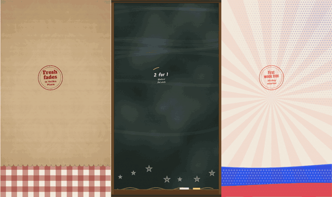
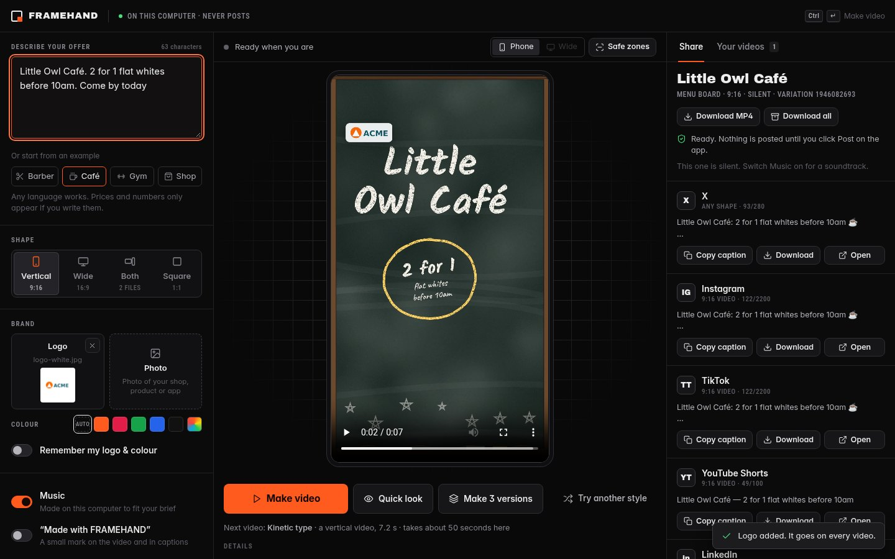

<div align="center">


# FRAMEHAND

**Write one line about your business. Get a short, unique promo video.**

Free and open source (MIT). Runs on your own computer. Never posts for you.

[](LICENSE)
[](https://github.com/300SpartanDev/framehand/releases/latest)
[](https://github.com/300SpartanDev/framehand/actions/workflows/test.yml)
[](https://framehand-rose.vercel.app)
[](#easiest-install-mac)
[](#easiest-install-windows)
[](https://github.com/300SpartanDev/framehand/stargazers)

**[Try it](https://framehand-rose.vercel.app) · [Install on Mac](#easiest-install-mac) · [Install on Windows](#easiest-install-windows) · [How it works](#how-it-works) · [Contributing](#contributing)**

</div>

<p align="center"></p>
<p align="center"><sub>Made from one line each: a barbershop, a café and a gym (9:16, for Reels and TikTok):<br>
<i>"Leo's Barbershop fresh fades in Velika Plana. Book today."</i> · <i>"Little Owl café. Weekend flat white, 2 for 1. Visit us on Main St this Saturday"</i> · <i>"Iron Current gym. 30-day starter, first week free."</i><br>
Still frames: <a href="docs/media/">docs/media</a> · Launch video: <a href="https://framehand-rose.vercel.app">framehand-rose.vercel.app</a></sub></p>

> **FRAMEHAND runs on your own computer, and it can't post for you.**
> Nothing is uploaded anywhere. When a video is ready, FRAMEHAND gives you the file and a caption,
> opens the upload page of the app you choose, and **you** click Post.

---

## What FRAMEHAND does

FRAMEHAND is a free app for small businesses (cafés, barbershops, gyms, shops, salons) that turns **one plain sentence** into a **branded promo video** for social media. No editing skills and no templates to fight with.

- **One line in, a video out.** Write something like *"Little Owl Café. 2 for 1 flat whites before 10am. Come by today"* and FRAMEHAND writes the scenes, animates them and adds music.
- **Your brand, not a template.** Add your logo and a photo. FRAMEHAND picks up your colours and puts your logo in every video, so it doesn't look like everyone else's CapCut or Canva post.
- **Every shape you need.** Vertical 9:16 for Reels, TikTok and YouTube Shorts, and wide 16:9 for X, LinkedIn and YouTube, from the same brief.
- **Ready-to-post captions.** A share pack for X, Instagram, TikTok, YouTube Shorts and LinkedIn: the video, a caption written for each app, and one click to open its upload page.
- **Any language.** Briefs, captions and on-screen text work in many languages and alphabets, including accents and right-to-left scripts.
- **Private and yours.** It runs on your own laptop. Nothing is uploaded, there's no account, and it **never posts for you**: you always press Post yourself.

## How it works

1. You type one line, e.g. *"Little Owl Café. 2 for 1 flat whites before 10am. Come by today"*.
2. FRAMEHAND reads what it's about and picks a matching look and scene plan (`cli/lib/compose-brief.js`).
   Shops lead with their offer; looks that need a chart, a formula or a screenshot are skipped when you don't give one.
3. Your logo, colours and photo are layered in (`cli/lib/brand-layer.js`) and a short original soundtrack is made on your computer.
4. Each video is a small web page (HTML + [GSAP](https://gsap.com) animation). It is drawn frame by frame in your own Chrome
   (or Edge on Windows), and **FFmpeg** turns the frames into an MP4.
5. You get the video (9:16, 16:9 or both) plus a caption written for each app (`cli/lib/caption.js`), and you post it yourself.

The styles live in [`templates/`](templates/); `node cli/om.js templates` lists them.

## Easiest install (Mac)

Open **Terminal**, paste this line, and press Enter:

```bash
curl -fsSL https://raw.githubusercontent.com/300SpartanDev/framehand/main/install.sh | bash
```

It downloads FRAMEHAND, installs what it needs, and puts a **Start Framehand** icon on your Desktop. To update later, run the same line again; your videos are kept.

## Easiest install (Windows)

Open **PowerShell** (press the Windows key, type *PowerShell*, press Enter), paste this line, and press Enter:

```powershell
irm https://raw.githubusercontent.com/300SpartanDev/framehand/main/install.ps1 | iex
```

It downloads FRAMEHAND to your user folder, installs Node.js and FFmpeg if they are missing (using winget, the app installer built into Windows 10 and 11), and puts a **Start Framehand** icon on your Desktop. Microsoft Edge, which comes with Windows, draws the frames, so you don't need Chrome. To update later, run the same line again; your videos are kept.

## 30-second start (Mac, by hand)

1. **Get the `framehand` folder:** download the latest release from <https://github.com/300SpartanDev/framehand/releases/latest>
   (under *Assets*, click **Source code (zip)**) and unzip it. The folder it makes (named like `framehand-0.4.1`) is your `framehand` folder.
   You can also click **Code → Download ZIP** on this page.
2. Install three free things (one time):
   - **Node.js 22** or newer — <https://nodejs.org> (pick "LTS", run the installer)
   - **FFmpeg** (makes the video files) — no Homebrew needed:
     download **ffmpeg** and **ffprobe** from <https://evermeet.cx/ffmpeg/> (or <https://www.ffmpeg.org/download.html>),
     unzip both, and put the two files in a folder called `bin` inside the `framehand` folder.
     *If you already use Homebrew, `brew install ffmpeg` does the same.*
   - **Google Chrome** — <https://www.google.com/chrome/> (FRAMEHAND uses it quietly to draw each frame)
3. Open the `framehand` folder and **double-click `run_ui.command`**.
   (First time only: right-click it → **Open** → **Open**, because macOS asks about files from the internet.
   Do the same once for `bin/ffmpeg` and `bin/ffprobe` if macOS says they are from an unidentified developer.)
   If something is missing, it tells you what and opens the download page.
   *On Windows, double-click **`run_ui.cmd`** instead (FFmpeg: `winget install -e --id Gyan.FFmpeg`, or put `ffmpeg.exe` and `ffprobe.exe` in the `bin` folder; Edge works as the browser).*
4. Your browser opens FRAMEHAND. Type one line, for example
   *"Little Owl Café. 2 for 1 flat whites before 10am. Come by today"* (or tap one of the examples), and press **Make video**.

<p align="center"></p>

Prefer the Terminal? In the `framehand` folder run:

```sh
node cli/om.js ui
```

Then open the address it prints (normally <http://127.0.0.1:7870/>).

---

## What you get

- **A different video every time.** FRAMEHAND reads what your line is about (a barbershop, a café, an app, a gym…)
  and picks a matching style — a printed shop poster, a café chalkboard, market-stall stamps, big bold type,
  a keynote-style launch, a whiteboard sketch, a paper collage, a chart and more. Shops lead with their offer. Press **Try another style**, or **Make 3 versions** to see three takes side by side and pick one.
- **Your words, your numbers.** It only shows numbers you wrote. No made-up statistics, no stock photos.
  Add your **logo** and an optional **photo of your shop, product or app** (JPG, PNG or iPhone HEIC): click, drag it
  anywhere onto the window, or paste it. Turn on **Remember my logo & colour** and they are there next time.
- **Vertical first.** Videos are 9:16 (Instagram Reels, TikTok, Shorts) unless you pick Wide (YouTube, X) or Both.
  The vertical video is laid out for phones: words, buttons and your logo stay clear of the app's own buttons.
- **Quick look first.** See three still frames in a few seconds before you make the full video.
- **Music.** A short original soundtrack is made on your computer (no internet). Switch it off with the Music toggle.
- **A caption written for each app.** Brand, offer and call to action, a few fitting hashtags, the right length
  for X, Instagram, TikTok, YouTube or LinkedIn. "Made with FRAMEHAND" is off unless you turn it on.
- **Your videos** stay listed in the app, so you can download, share or delete them later.
- **Safe zones.** Switch them on over the phone preview to see where TikTok and Reels put their buttons and caption.
- **Keyboard.** ⌘ Enter (Ctrl Enter on Windows) makes the video.

## Sharing

Under **Share**, every app has three buttons: **Copy caption** (written for that app), **Download** (the right video —
vertical for Reels, TikTok and Shorts) and **Open** (that app's upload page). **Download all** gets every app's video and
caption in one .zip. You attach the video, paste the caption and click Post yourself.

## Your data

Everything you make — videos, quick looks, uploaded logos and photos, share packs, your remembered logo and colour —
is kept on your computer in one folder, **outside** the FRAMEHAND folder, so it never ends up in a copy you share:

- Mac: `~/Library/Application Support/FRAMEHAND`
- Windows: `%APPDATA%\FRAMEHAND`
- Linux: `~/.local/share/framehand`

The video engine also keeps a small notes file and a soundtrack history in `~/.framehand`.

To start fresh (delete all of it), run `npm run clean` in the FRAMEHAND folder (or `node cli/om.js reset --yes`).
`node cli/om.js reset` without `--yes` only shows what it would delete.

---

## For developers

The command-line tool is `node cli/om.js` (also installed as `om` / `framehand` if you `npm link`).

| Command | What it does |
|---|---|
| `node cli/om.js doctor` | Checks Node, Chrome and FFmpeg |
| `node cli/om.js reset --yes` | Deletes everything made in the app (same as `npm run clean`) |
| `node cli/om.js ui` | The app (local only, 127.0.0.1) |
| `node cli/om.js templates` | Lists the styles |
| `node cli/om.js new my-film --template kinetic-type` | Starts a project from a style |
| `node cli/om.js render my-film` | Renders `out/*.mp4` |
| `node cli/om.js x-demo my-film` | Writes an X post draft (never posts) |
| `node cli/om.js help` | Everything else |

Requirements: Node.js 22+, FFmpeg (`ffmpeg` and `ffprobe`), and Chrome, Chromium, Edge or Brave (or set `OM_CHROME` to a browser's path).

Tests: `npm test`. CI runs the tests on Linux and a render smoke test on Windows ([workflow](.github/workflows/test.yml)).
The agent skill lives in [`skills/framehand/SKILL.md`](skills/framehand/SKILL.md).

## Contributing

Bug reports, style ideas and pull requests are welcome. The short version:

1. Fork and clone the repo, then run `node cli/om.js doctor` to check Node, Chrome and FFmpeg.
2. Make your change and run `npm test`.
3. Open a pull request. For bigger changes, please open an issue first so we can talk about it.

Styles live in [`templates/`](templates/), the engine in [`cli/lib/`](cli/lib/) and [`runtime/`](runtime/).
New here? Look for issues labelled [`good first issue`](https://github.com/300SpartanDev/framehand/labels/good%20first%20issue).
Details: [CONTRIBUTING.md](CONTRIBUTING.md).

## Credits

FRAMEHAND is a consumer-focused version of an open-source motion-graphics engine, originally published under the MIT License
(Copyright (c) 2026 Huashu). See [NOTICE.md](NOTICE.md), and [FORK.md](FORK.md) for what this version adds.
Fonts and libraries (including GSAP): [THIRD_PARTY.md](THIRD_PARTY.md).

## License

MIT — see [LICENSE](LICENSE) and [NOTICE.md](NOTICE.md). Third-party parts: [THIRD_PARTY.md](THIRD_PARTY.md).
Notes on this version: [FORK.md](FORK.md).

---

<p align="center">If FRAMEHAND saved you an afternoon of editing, a ⭐ helps other small businesses find it.</p>
